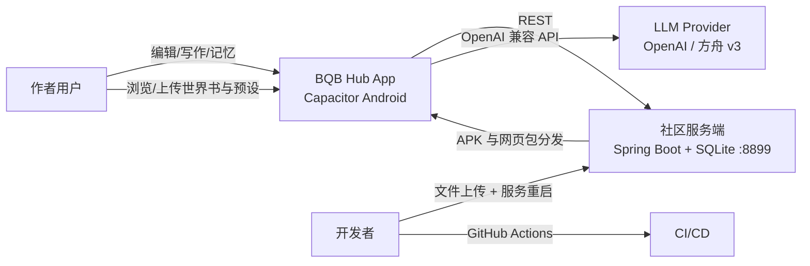
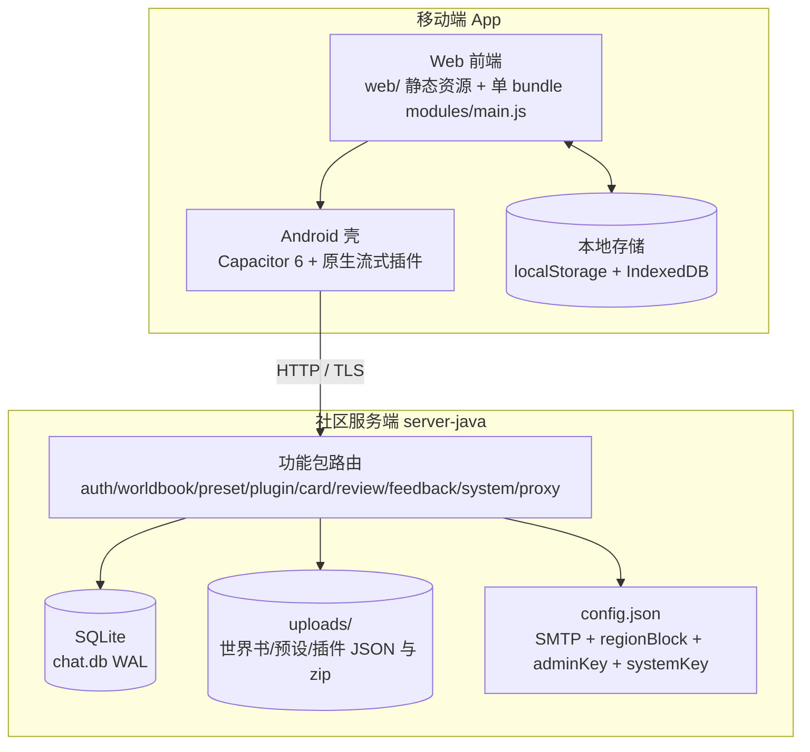

# BQB Hub 架构（C4）

> 目标形态（工程化进行中）。Level 1-2 为现状与目标混合描述，Level 3 标注当前实现。
> 线上实现是 **Java 版**（`server-java/`，2026-10-10 切换）；Node 版（`server/`）冻结为参考实现与回滚备份，见 [ADR-0004](adr/ADR-0004-node-freeze.md)。

## Level 1 · 系统上下文



## Level 2 · 容器



## Level 3 · 服务端组件（Java，功能包 + 三层）

每个领域包 = `XController`（解析/守卫/状态码）→ `XService`（业务规则、事务、限额口径）→ `XRepository`（SQL）；
边界由 `LayeringTest`（ArchUnit）执行，决策见 [ADR-0005](adr/ADR-0005-backend-layers.md)。

```text
server-java/src/main/java/bqbhub/server/
├── ServerApplication.java     # 入口
├── AppConfig.java             # 配置中心（环境变量 + config.json，口径与 Node 版一致）
├── Db.java                    # Hikari + xerial SQLite（WAL / busy_timeout / IMMEDIATE）
├── SchemaMigrations.java      # 建表 + 老库就地升级 + PRAGMA user_version 编号（ADR-0006）
├── Beans.java / ApiFilter.java / ApiError*.java / TlsConfig.java
├── AuthService.java           # 会话原语（token / 管理员 / 系统版判定），全领域共用
├── Validators.java / Social.java / Media.java / Mailer.java / Limiters.java /
│   RateLimiter.java / Scrypt.java / DayKey.java / AdminToken.java / Region.java / ReviewLog.java
├── support/                   # 共享守卫：AdminGuard（管理员令牌）/ AdminKeyGuard（运维口令）/ Visibility（行级可见性）
├── auth/                      # 账号流程（验证码 / 注册 / 登录 / 重置 / 改昵称）
├── worldbook/                 # 世界书（WbSearch 检索引擎 / WorldbookMeta 元数据）
├── preset/  plugin/  card/    # 预设 / 插件 / 卡片社交（点赞评论）
├── review/                    # 审核队列 + 我的投稿
├── feedback/                  # 意见反馈
├── system/                    # 分发（健康/版本/APK/网页包）/ 遥测（心跳/统计/日志）/ 管理员（令牌/留档）
└── proxy/                     # CORS 代理（白名单 + 流式透传）
```

## 模块依赖与迁移状态

| 层 | 模块 | 状态 |
|---|---|---|
| 服务端 | `server-java/`：9 个领域包（Controller/Service/Repository）+ 根包基础设施 | ✅ 分层完成（ADR-0005）；`mvn test` 96 例（含 ArchUnit 边界规则与跨语言口令夹具）；契约套件对 jar 91 例（88 通过 + 3 嵌入专用跳过）；CI 四个 job |
| 前端 | 单 bundle `web/modules/main.js`（TS 源码在 `app/src`，由 `npm run sync:legacy` 生成） | ✅ 30/30 统一管线化 + 全库 strict 类型检查（无 @ts-nocheck）；usage/settingsync 已 import 化（P1）；4 个超大文件 app/ui/community/cardwriter 待拆分（F009）；vitest 1617 例 |

## 关键设计决策

- **数据本地优先**：写作数据在 IndexedDB/localStorage，服务器只持有社区数据（用户/世界书/预设/插件）。
- **SQLite + WAL**：xerial sqlite-jdbc + Hikari（无外部服务）；`journal_mode=WAL` + `busy_timeout=5000` + `transaction_mode=IMMEDIATE`。
- **接口契约即验收**：Node 与 Java 共用一套黑盒契约用例（`server/tests/CONTRACT.md`，`CONTRACT_CMD` 指向任一实现）；
  Node 冻结后只在 Java 上跑（ADR-0004）。
- **结构迁移编号化**：`PRAGMA user_version` 唯一标记、Java 独占维护、纯增量 + 带默认值（ADR-0006）。
- **地区限制布尔化**：`config.regionBlock` 一个开关控制请求拦截（见 ADR-0002）。
- **API 风格**：统一 JSON 错误体 `{error: string}`；未登录 401 / 越权 403 / 不存在 404。

## 部署拓扑（现状）

主机地址、端口与运维命令见本地文档 `docs/部署与提交流程.md`（**不入库**）。服务端目录结构：

```text
/server-java
├── bqbhub-server-java.jar   # 线上运行入口（systemd bqbhub-java）
├── bqbhub-server-java.jar.bak-*   # 历次切换的备份
├── deploy/                  # bqbhub-java.service / canary-setup.sh / flip-to-java.sh
└── tools/smoke.mjs          # 灰度演练的冒烟对比脚本
/server
├── app-version.json         # 版本分发源
├── apk/*.apk                # APK 文件（分发目录）
├── web-bundles/             # 网页包热更新（manifest.json / manifest-beta.json + zip）
├── uploads/                 # 世界书 / 预设 / 插件载荷
├── data/chat.db             # SQLite（WAL）
└── config.json              # SMTP + regionBlock + adminKey + adminPasswordHash + systemKey（不入库）
```

> 2026-08 线上从单文件 index.js 切到分层 Node 版；2026-10-10 换栈到 Java 版并灰度切换（`bqbhub-java` active+enabled），
> Node 版保留为回滚目标（`flip-to-java.sh` 失败会自动回滚到 `novel-community`）。
